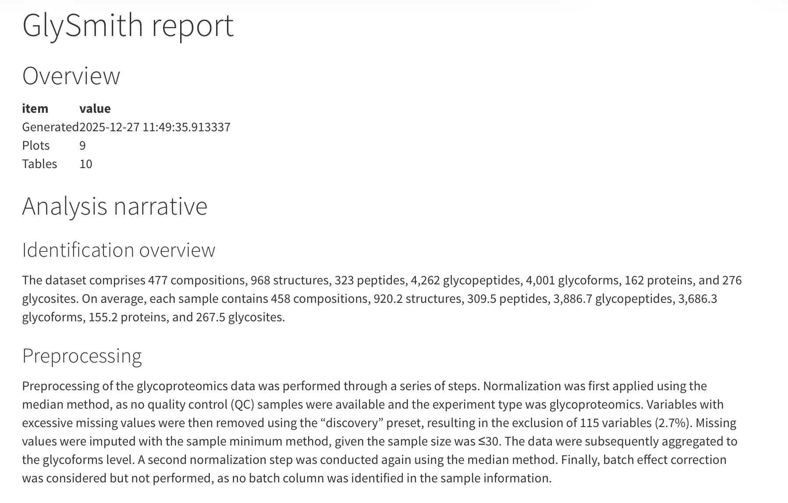

# glysmith

> **One Ring to rule them all.** — *The Lord of the Rings*


Be overwhelmed by the complexity of glycoverse?

Imagine a package, performing all analysis you need, PCA, DEA,
enrichment, or even advanced glycan derived trait analysis, in just one
line of code.

Try glysmith! Perform the comprehensive analysis pipeline with one
function call.

<https://github.com/user-attachments/assets/d1eede5f-f919-428b-a5e8-574a8ab6f863>

## Installation

### Docker (recommended)

glysmith needs a lot of dependencies, so the best way to use it is
through [Docker](https://www.docker.com/products/cli/).

The Docker image includes R, glysmith, its optional analysis
dependencies, the core Glycoverse packages, and Pandoc for HTML reports.
It is available on both [Docker
Hub](https://hub.docker.com/r/fubin1999/glysmith) and [GitHub Container
Registry](https://github.com/glycoverse/glysmith/pkgs/container/glysmith).

Run these commands from your analysis directory to start an interactive
R session. Remember to replace `/workspace` with your own analysis
directory.

``` sh
docker run --rm -it \
  --mount "type=bind,source=$(pwd),target=/workspace" \
  fubin1999/glysmith:latest
```

At the R prompt, run
[`library(glysmith)`](https://glycoverse.github.io/glysmith/), then
start using glysmith interactively. The result files will be saved to
`/workspace` or your analysis directory.

For Linux file permissions, versioned tags, verification, and local
builds, see the [Docker
guide](https://github.com/glycoverse/glysmith/blob/main/docker/README.md).

### Install in R

You can also use glysmith in an existing R environment, by installing it
as a normal R package. Install the latest release from
[r-universe](https://glycoverse.r-universe.dev/glysmith) with `pak`.

``` r

# install.packages("pak")
pak::repo_add(glycoverse = "https://glycoverse.r-universe.dev")
pak::pkg_install("glysmith")
```

After installation, check the packages required by the default analysis
blueprint.

``` r

glysmith::check_glysmith_deps()
```

For troubleshooting, see the [glycoverse installation
guide](https://github.com/glycoverse/glycoverse#installation).

## Example

``` r

library(glyread)
library(glysmith)

exp <- read_pglyco3("pglyco3_result.txt", sample_info = "sample_info.csv")

# One line of code for the comprehensive analysis pipeline
result <- forge_analysis(exp)

# One line of code to save the results
quench_result(result, "path/to/save")

# One line of code to generate a report
polish_report(result, "report.html", open = FALSE)
```

After running the above `quench_result` line, you will get an organized
result folder:


Open `report.html` from your analysis directory in your browser.



*The report shown above was generated with `use_ai = TRUE`.*
